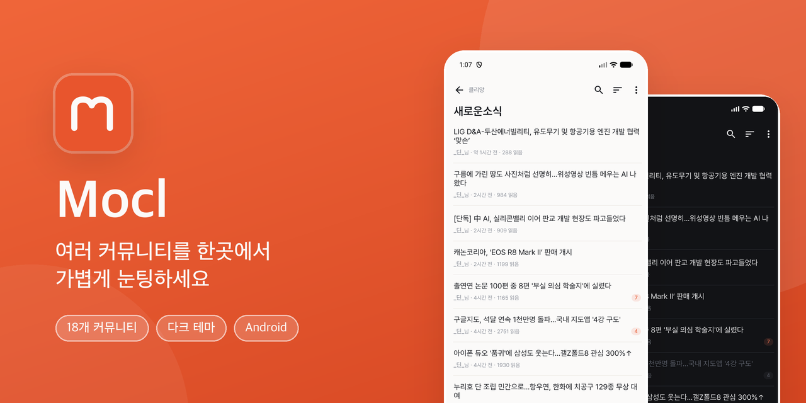
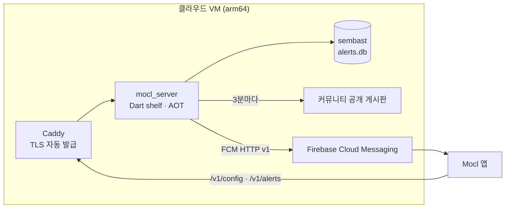

# mocl_flutter

<p align="center">
  <a href="https://play.google.com/store/apps/details?id=kr.b1ink.mocl">
    
  </a>
</p>

간단한 눈팅 앱으로 Arcalive, Bobaedream, Clien, Cook82, DCInside, Damoang, Dogdrip,
GeekNews, Instiz, Inven, Meeco, MLBPark, Nate, NaverCafe, Ppomppu, Reddit, Ruliweb, TheQoo
사이트를 제한적으로 지원합니다.

<a href="https://play.google.com/store/apps/details?id=kr.b1ink.mocl"></a>

## 기술 스택

- **Flutter** >= 3.44.0 / **Dart** ^3.12.0
- **Android 빌드**: Gradle 9.5 / AGP 9.2 / Kotlin 2.3
- **버전 관리**: FVM (`.fvmrc` 로 Flutter 버전 고정)
- **상태관리 & DI**: flutter_riverpod + riverpod_annotation (code gen)
- **아키텍처**: Clean Architecture (domain → data → application → presentation)
- **라우팅**: go_router
- **네트워크**: dio + cookie_jar (timeout 15s 통일)
- **HTML 파서**: html 패키지 (워커 isolate 분리)
- **코드 생성**: freezed, json_serializable, riverpod_generator
- **빌드 플레이버**: dev, prd
- **데이터베이스**: sembast
- **광고**: Google AdMob 네이티브 광고(Android 만, UMP 동의 → SDK 초기화 후 요청)
- **서버**: Dart(shelf) + Docker + Caddy, arm64 클라우드 VM — 원격 설정 · 키워드 알림(FCM). 앱과 파서를 `packages/mocl_shared` 로 공유
- **앱 아이콘/스플래시**: flutter_launcher_icons + flutter_native_splash (소스: `branding/`)

## 프로젝트 구조

```
lib/
├── config/                        # 앱 설정 (테마, 라우트)
│   └── routes/                    # GoRouter 설정
├── core/                          # 공통 모듈
│   ├── application/               # 공통 Provider (AppFontState 등)
│   ├── domain/                    # 공통 Entity, Repository(abstract), UseCase
│   ├── data/                      # 공통 Repository(concrete), DataSource
│   ├── error/                     # 에러/Failure 정의
│   ├── presentation/              # 공통 위젯 & 모델
│   └── util/                      # 유틸리티
├── features/                      # 기능 모듈
│   ├── main_page/                 # 메인 화면
│   ├── list_page/                 # 글 목록
│   ├── detail_page/               # 글 상세
│   ├── login_page/                # 로그인 (InAppWebView)
│   ├── add_main_dialog/           # 게시판 추가 다이얼로그
│   ├── settings_page/             # 설정
│   ├── ads/                       # AdMob 네이티브 광고 (목록 · 메인 · 상세)
│   ├── html_parser/               # 사이트별 HTTP(*_api.dart). 파서는 packages/mocl_shared
│   ├── remote_config/             # 서버 원격 설정(UA 등) 캐시 · 갱신
│   ├── keyword_alerts/            # 키워드 알림 구독 · FCM 수신(서버가 크롤)
│   ├── database/                  # 로컬 DB (sembast)
│   ├── network/                   # 네트워크 에러 처리
│   └── google_drive/              # 구글 드라이브 백업
└── i18n/                          # 다국어 지원

packages/mocl_shared/              # 앱 · 서버 공용(순수 Dart): 엔티티, Failure, MoclLogger, 파서, RemoteConfig
server/                            # Dart(shelf) 서버 — server/README.md
```

### Feature 모듈 구조 (Clean Architecture)

```
features/{feature_name}/
├── domain/
│   ├── entities/                  # 도메인 모델
│   ├── repositories/              # Repository 인터페이스
│   └── usecases/                  # 비즈니스 로직
├── data/
│   ├── datasources/               # 원격/로컬 데이터소스
│   ├── models/                    # DTO (JSON 변환)
│   └── repositories/              # Repository 구현체
├── application/
│   ├── use_case_provider.dart     # UseCase Provider
│   └── {feature}_providers.dart   # 상태 Provider (@riverpod)
└── presentation/
    ├── state/
    │   ├── {feature}_event_mixin.dart  # Event (ref.read → 상태 변경)
    │   └── {feature}_state_mixin.dart  # State (ref.watch → 상태 조회)
    ├── widgets/                   # 위젯 컴포넌트
    └── {feature}_view.dart        # 화면 진입점
```

## 상태관리 패턴: Mixin Class

Riverpod Provider를 **mixin class를 통해서만** 접근하도록 캡슐화합니다.

### 규칙

- **Event mixin**: `ref.read()`로 상태 변경 (사용자 액션 처리)
- **State mixin**: `ref.watch()`로 상태 조회 (UI 바인딩)
- **위젯**: Provider를 직접 import하지 않고, mixin을 `with`로 합성

### 예시

```dart
// Event — 상태 변경만 담당
mixin class ListEvent {
  void handleRefresh(WidgetRef ref) =>
      ref.read(pageStateProvider.notifier).refresh();
}

// State — 상태 조회만 담당
mixin class ListState {
  (int, bool, String?) listState(WidgetRef ref) => ref.watch(
    pageStateProvider.select(
      (value) => value.when(
        data: (state) => (state.items.length, state.hasReachedMax, state.error),
        loading: () => (0, false, null),
        error: (err, stack) => (0, false, err.toString()),
      ),
    ),
  );
}

// Widget — mixin으로만 Provider 접근
class MoclListView extends ConsumerWidget with ListState, ListEvent {
  @override
  Widget build(BuildContext context, WidgetRef ref) {
    final (count, hasMax, error) = listState(ref);
    // ...
  }
}
```

### Import 규칙

위젯에서 `application/` provider 파일을 직접 import하는 것을 금지합니다.

| 파일 위치 | application/ import | 허용 여부 |
|-----------|-------------------|----------|
| `presentation/state/*.dart` (mixin) | Provider 접근 | O |
| `presentation/*.dart` (view) | Provider 직접 접근 | X |
| `presentation/widgets/*.dart` | Provider 직접 접근 | X |

> `core/application/`은 공통 mixin(`AppFontState` 등)이 포함되어 있으므로 예외

```bash
# import 규칙 검사
dart run tool/check_provider_imports.dart
```

## 개발 환경 설정

### Flutter 버전 (FVM)

이 프로젝트는 `.fvmrc` 로 Flutter 버전을 고정합니다.

```bash
# fvm 설치
brew tap leoafarias/fvm
brew install fvm

# 프로젝트 사용 버전 설치
fvm install

# 이후 모든 flutter / dart 명령에 fvm 접두사 사용
fvm flutter pub get
fvm dart run build_runner build
```

`fvm` 미설치 환경에서는 시스템 Flutter 가 `>=3.44.0` 인지 확인.

### 코드 생성 (build_runner)

```bash
fvm dart run build_runner build --delete-conflicting-outputs
```

### 실행

```bash
# 개발
fvm flutter run --flavor dev --dart-define-from-file=ads.json

# 프로덕션
fvm flutter run --flavor prd --dart-define-from-file=ads.json

# 프로파일
fvm flutter run --profile --flavor prd --dart-define-from-file=ads.json
```

`ads.json` 은 AdMob ID 파일입니다(저장소에 없음, [AdMob ID](#admob-id) 참고).
없으면 `--dart-define-from-file` 을 빼고 실행하면 테스트 광고로 동작합니다.

### 빌드

```bash
# Android (ads.json 없이 빌드하면 테스트 ID 가 들어가 수익이 나지 않는다)
fvm flutter build apk --flavor prd --dart-define-from-file=ads.json
fvm flutter build appbundle --flavor prd --dart-define-from-file=ads.json

# iOS (XCode에서 인증서 세팅 필요)
cd ios && pod install && cd ..
fvm flutter build ipa --flavor prd
```

### 정적 분석

```bash
# Dart 분석
fvm flutter analyze

# Provider import 규칙 검사 (pre-commit hook 에서도 자동 실행)
fvm dart run tool/check_provider_imports.dart
```

## 앱 아이콘 / 스플래시

아이콘·스플래시는 `flutter_launcher_icons` / `flutter_native_splash` 로 자동 생성합니다.
밀도별 리소스(`android/.../mipmap-*`, `drawable-*`, iOS AppIcon 등)를 **직접 수정하지 말고**,
아래 소스 이미지를 교체한 뒤 재생성하세요.

### 소스 이미지 (`branding/`)

| 파일 | 용도 |
|------|------|
| `app_icon.png` | 앱 아이콘 (오렌지 배경 + 흰 m) — iOS/레거시 |
| `icon_foreground.png` | 적응형 아이콘 전경 (투명 + 흰 m) |
| `icon_monochrome.png` | Android 13+ 테마(모노크롬) 아이콘 실루엣 |
| `splash.png` | 스플래시 중앙 아이콘 (투명 + 오렌지 m) |

설정 파일: [`flutter_launcher_icons.yaml`](flutter_launcher_icons.yaml), [`flutter_native_splash.yaml`](flutter_native_splash.yaml)

### 재생성

```bash
fvm dart run flutter_launcher_icons -f flutter_launcher_icons.yaml
fvm dart run flutter_native_splash:create --path=flutter_native_splash.yaml
```

### 동작

- **스플래시 배경**: 라이트 `#FBFAF9` / 다크 `#121316` (m 은 오렌지 공통, 배경색만 테마별 분기)
- **런처 아이콘**: 적응형(Android 8+) + 모노크롬(Android 13+ 테마 아이콘) 지원

## 서버 (`server/`)

앱만으로는 할 수 없는 기능(여러 커뮤니티를 가로지르는 알림 · 앱 업데이트 없는 설정 변경)을 위한
자체 서버입니다. 상세 사용법 · 배포 · 운영은 [server/README.md](server/README.md) 를 보세요.

**원칙**
- 서버가 없거나 죽어도 앱의 기본 기능(목록 · 상세 · 스크랩 등)은 그대로 동작한다. 서버 기능은 모두 부가 기능이다.
- 서버는 공개 페이지의 제목 · 링크 · 메타만 다룬다. 본문을 저장 · 재배포하지 않는다.
- 사용자의 사이트 로그인 쿠키는 서버로 보내지 않는다.

### 구성



- **공유 패키지** `packages/mocl_shared`: 엔티티 · 사이트 파서 · 원격 설정 · 알림 계약을 앱과 서버가 같이 쓴다(순수 Dart).
  사이트 마크업이 바뀌면 한 번 고쳐서 앱과 서버에 함께 반영된다.
- **배포**: Docker(AOT 컴파일, 빌드 중 테스트) + Caddy. `server/docker-compose.yml`.
- **서버 주소**: 저장소에 두지 않는다. 앱은 `MOCL_API_BASE_URL` define(`ads.json`)으로 받는다. 비면 서버 기능이 꺼진다.

### 기능

| 기능 | 내용 | 앱 |
|---|---|---|
| 원격 설정 | 사이트별 요청 UA 를 앱 업데이트 없이 바꾼다. 부팅 땐 저장된 값을 쓰고, 새 값은 **다음 실행부터** 적용 | `features/remote_config/` |
| 이슈 레이더 | 11개 커뮤니티 베스트 · 자유게시판을 5분마다 모아 비슷한 제목끼리 묶고, 여러 커뮤니티에 걸친 화제를 점수순으로 보여 준다 | `features/issue_radar/` (드로어 → 지금 이슈) |
| 키워드 알림 | 담은 게시판에 키워드를 걸면 서버가 3분마다 새 글을 보고, 제목이 맞으면 푸시. 누르면 그 글 상세로 이동 | `features/keyword_alerts/` (설정 → 키워드 알림, 목록 앱바 종 버튼) |

### API

| 경로 | 설명 |
|---|---|
| `GET /healthz` | `ok` |
| `GET /healthz/crawl` | 크롤러 상태. 10분 넘게 멈추면 `503` |
| `GET /v1/config` | 원격 설정(`RemoteConfig`). ETag / `304` |
| `GET /v1/issues` | 이슈 목록(`IssueFeed`). ETag / `304`. 수집 직후 계산해 둔 캐시를 내보낸다 |
| `GET /v1/issues/{id}` | 이슈 하나 |
| `PUT /v1/alerts/{installId}` | 기기의 알림 구독 전체를 덮어쓴다(`AlertRegistration`). 구독이 비면 삭제 |
| `DELETE /v1/alerts/{installId}` | 알림 등록 삭제 |

알림 API 는 IP 당 분당 30회 · 본문 64KB 로 제한하고, 게시판 URL 은 지원 사이트 도메인만 받는다(SSRF 방지).

### 키워드 알림이 지원하는 사이트

서버(클라우드 데이터센터 IP)에서 **실제로 받아 본 결과**로 정했습니다(`server/bin/probe.dart`).

| 구분 | 사이트 |
|---|---|
| 지원 | 보배드림 · 클리앙 · 82쿡 · 다모앙 · 디시인사이드 · 개드립 · 긱뉴스 · 인벤 · 미코 · MLBPARK · 네이트판 · 뽐뿌(RSS) |
| 서버 IP 차단 | 아카라이브 · 인스티즈 · 더쿠 · 루리웹 |
| 로그인 필요 | 네이버카페 · 레딧 |

- 같은 게시판은 구독자 수와 상관없이 3분에 한 번만 받는다(사이트 부담 = 게시판 수).
- 게시판 첫 크롤은 지금 글을 기록만 한다(옛 글로 알림이 쏟아지지 않게). 실패하면 간격을 최대 60분까지 늘린다.
- 무효 FCM 토큰(앱 삭제 등)이면 그 기기 등록을 지운다.

### 이슈 레이더

- 게시판: 디시 실베 · 네이트판 랭킹 · 보배 베스트 · 개드립 붐업 · 인벤 오픈이슈 · 긱뉴스(가중치 1.0~0.8),
  클리앙 공원 · 다모앙 자유 · 엠팍 불펜(0.7), 미코 · 82쿡 자유(0.5). 정의는 `server/lib/src/radar/radar_boards.dart`.
- 점수 = Σ 가중치 × 신선도(반감기 3시간) × (1 + 사이트 안 반응 순위) × (1 + 0.5 × (커뮤니티 수 − 1)).
- 시각은 서버가 처음 본 시각(사이트마다 형식이 달라 믿지 않는다), 반응은 사이트 안 순위로만 비교.
- 묶기 품질은 실제 데이터로 확인한다: `docker run ... dart run bin/radar_eval.dart /data/radar.db [θ]` (server/README).

### 배포 · 운영 요약

```bash
ssh <서버>
cd ~/mocl/server && docker compose up -d --build   # 갱신
docker compose logs -f api                          # 로그
```

| 항목 | 위치 / 주기 |
|---|---|
| 원격 설정 파일 | `server/config/remote_config.json` (고치면 재시작 없이 다시 읽음, 잘못되면 직전 설정 유지) |
| FCM 발송 키 | 서버 `~/mocl/server/secrets/firebase-service-account.json` (**git 밖**. 없으면 dry-run) |
| 도메인 · 알림 토픽 | 서버 `~/mocl/server/.env` (`MOCL_DOMAIN`, `NTFY_TOPIC`) |
| 백업 | `ops/backup.sh` 매일 04:30 KST → `~/backup/mocl/`, 14일 보관 |
| 감시 | `ops/healthcheck.sh` 5분마다. 상태가 바뀔 때만 ntfy 로 알림 |

- 같은 서버 안의 검사라 인스턴스가 통째로 죽으면 알 수 없다 → 외부 감시(UptimeRobot 등)로 `/healthz/crawl` 도 본다.
- Always Free 인스턴스는 사용률이 낮으면 회수될 수 있다 → 계정을 종량제(PAYG)로 두면 회수 대상에서 빠진다.

### 남은 일

- iOS 푸시: Firebase 콘솔 APNs 키 + Xcode Push Notifications · Background Modes (iOS 출시 때)
- CI Secret `ADS_JSON` 에 `MOCL_API_BASE_URL` 추가(없으면 스토어 빌드에서 서버 기능이 꺼진다)

## 보안 / 시크릿 관리

### Firebase 설정 파일은 시크릿이 아닙니다

[`lib/firebase_options.dart`](lib/firebase_options.dart), `google-services.json`,
`GoogleService-Info.plist` 에는 `apiKey` 가 평문으로 들어 있고, **의도적으로 커밋합니다.**

Firebase API 키는 프로젝트와 앱을 **식별**할 뿐 권한을 부여하지 않습니다. 실제 인가는
Google Cloud IAM · Firebase Security Rules · App Check 가 담당합니다
([공식 문서](https://firebase.google.com/docs/projects/api-keys)).

또한 이 값들은 빌드 산출물에 반드시 포함되므로, APK/IPA 에 `strings` 만 돌려도 그대로
추출됩니다. **`.gitignore` 로 감추거나 난독화해도 보안상 이득은 없고 빌드만 깨집니다.**
방어선은 "키를 숨기는 것"이 아니라 **"키로 할 수 있는 일을 제한하는 것"** 입니다.

### 커밋 가능 여부

| 커밋해도 되는 것 | 절대 커밋하면 안 되는 것 |
|---|---|
| `lib/firebase_options.dart` | 서비스 계정 JSON (Admin SDK) |
| `android/app/google-services.json` | 릴리스 키스토어 (`*.jks`), `key.properties` |
| `{ios,macos}/Runner/GoogleService-Info.plist` | OAuth **client secret**, 서버 API 키 · `server/secrets/` · `server/.env` |
| OAuth client **ID** | Play / App Store Connect API 키 |

우변에 해당하는 값이 실수로 커밋되면 히스토리를 되돌리는 것만으로는 부족합니다.
**해당 자격증명을 즉시 폐기하고 재발급**해야 합니다.

### AdMob ID

실제 AdMob 앱 ID · 광고 단위 ID 는 저장소에 없습니다. 루트에 `ads.json` 을 만들어
(`ads.example.json` 복사) 빌드에 넣습니다. 없으면 Google 테스트 ID 로 빌드되어 테스트
광고만 나옵니다. **포크해서 배포한다면 본인 AdMob ID 를 쓰세요.**

- debug · profile 빌드는 `ads.json` 이 있어도 테스트 단위만 씁니다(실제 광고를 누르면 계정 정지).
- 앱 ID 는 `android/app/build.gradle.kts`, 광고 단위는 `AdUnitIds` 가 읽습니다.

```bash
fvm flutter run --flavor dev --dart-define-from-file=ads.json
fvm flutter build appbundle --flavor prd --dart-define-from-file=ads.json
```

GitHub Actions 는 Secrets `ADS_JSON`(위 JSON 전체)으로 `ads.json` 을 만듭니다.
서버 주소(`MOCL_API_BASE_URL`)도 같은 파일에 넣습니다(비밀값은 아니지만 빌드마다 다를 수 있어 define 으로 받는다).

### 서명 키 취급

릴리스 서명 정보는 저장소 **바깥**에 두고 주입합니다
([android/app/build.gradle.kts](android/app/build.gradle.kts) 참고).

| 환경 | `key.properties` 위치 |
|------|----------------------|
| 로컬 | `../../keystore/key.properties` (저장소 밖) |
| GitHub Actions | `android/key.properties` (시크릿에서 워크플로가 생성, 커밋 안 함) |

### Firebase 프로젝트 운영 체크리스트

키가 공개돼 있는 만큼, 보호는 콘솔 설정으로 합니다.

1. **미사용 서비스 잠그기 (최우선)** — 앱은 `firebase_core` + `firebase_crashlytics`
   만 사용합니다. Realtime Database · Cloud Storage 를 쓰지 않으면 **삭제**하고,
   남긴다면 규칙을 잠급니다. `firebase_options.dart` 에 `databaseURL` 과
   `storageBucket` 이 공개돼 있으므로, 테스트 모드 규칙이 켜져 있으면 그대로 뚫립니다.

   ```
   // RTDB
   { "rules": { ".read": false, ".write": false } }
   ```
   ```
   // Cloud Storage
   rules_version = '2';
   service firebase.storage {
     match /b/{bucket}/o { match /{allPaths=**} { allow read, write: if false; } }
   }
   ```

2. **API 키 제한** — GCP Console → API 및 서비스 → 사용자 인증 정보에서 키마다 설정.

   | 키 | 애플리케이션 제한 |
   |---|---|
   | Android | Android 앱 → 패키지명 + 릴리스/디버그 SHA-1 지문 |
   | iOS | iOS 앱 → 번들 ID (`net.b1ink.moclFlutter`) |
   | Web | HTTP 리퍼러 (웹 미배포 시 항목 자체를 제거하는 편이 낫다) |

   API 제한은 실제 사용하는 Firebase API 만 허용합니다.
   **유료 API(Maps, Gemini 등)는 공개 키의 허용 목록에 넣지 마세요** — 과금 남용으로 직결됩니다.

3. **App Check** — Play Integrity(Android) / App Attest(iOS). 현재는 사용 서비스가 적어
   급하지 않지만, Firestore·Functions 를 도입하는 시점에는 필수입니다.

4. **예산 알림** — Cloud Billing 예산 알림을 걸어두어 남용을 청구서보다 먼저 인지합니다.

## 운영 메모

- **Dio timeout**: 백그라운드 → 포그라운드 복귀 시 소켓 사망으로 멈추는 현상을
  방지하기 위해 connect/receive/send timeout 모두 15 초로 통일.
  `_buildDio()` ([network_provider.dart](lib/features/network/application/network_provider.dart)) 참고.
- **PagingController 복구**: 리스트 화면은 `AppLifecycleState.resumed` 시
  `ListPagingController.kickIfStale()` 을 호출해 멈춘 fetch 를 강제 재시작
  ([mocl_list_view.dart](lib/features/list_page/presentation/mocl_list_view.dart)).
- **사이트별 파서**: `*_api.dart` (HTTP) 는 `lib/features/html_parser/data/datasources/{site}/`,
  `*_parser.dart` (HTML → Entity) 는 서버와 같이 쓰도록 `packages/mocl_shared/lib/parser/{site}/` 에 있다.
  파서는 워커 isolate (`ParserIsolateClient`) 에서 실행되어 메인 isolate 를 차단하지 않음.
